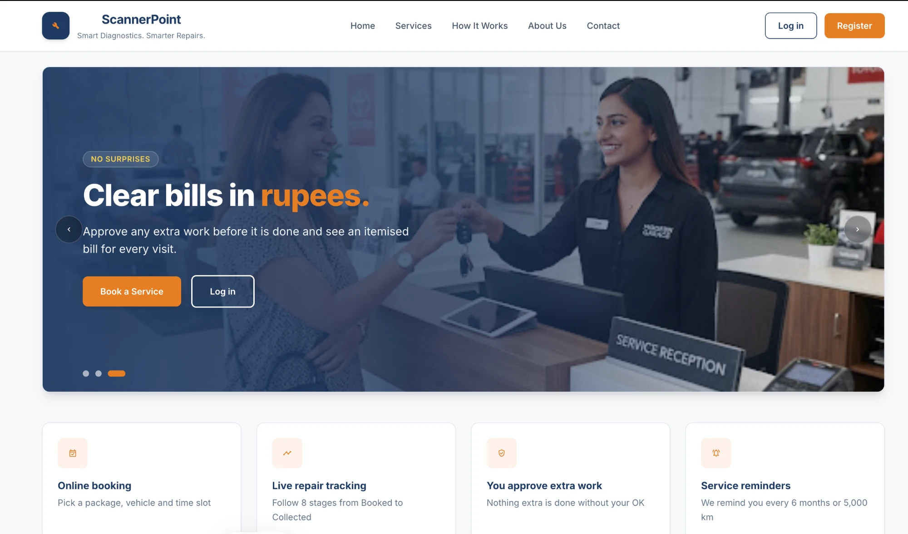
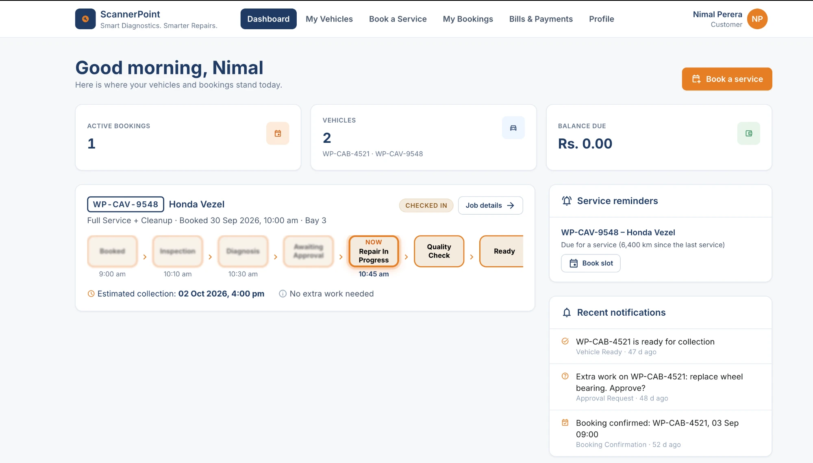
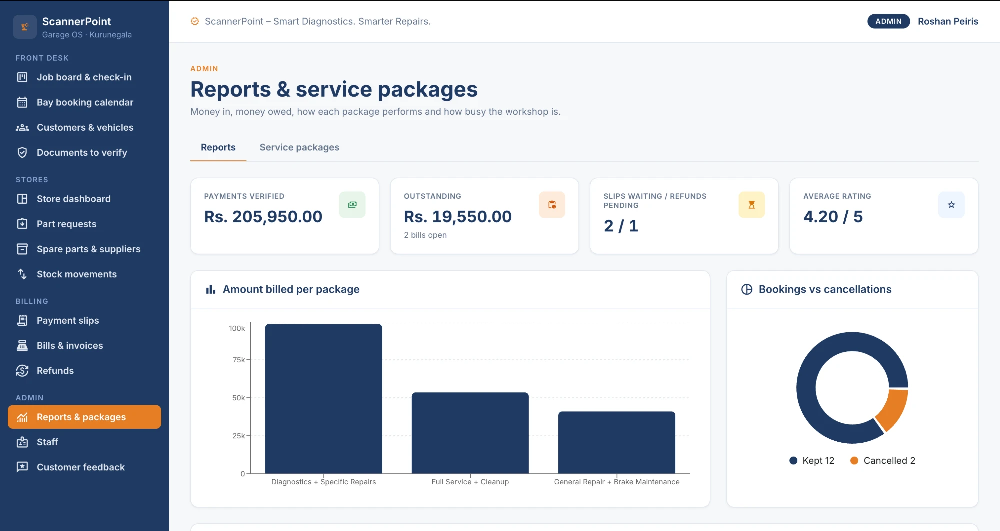

# ScannerPoint – Smart Garage Management System

**Smart Diagnostics. Smarter Repairs.**

ScannerPoint replaces a garage's paper job cards, phone bookings and manual stock books with one role-based web
application that covers the full journey of a vehicle – from online booking to collection.

🌐 **Live site:** https://scanner-point-se-2012-grp-08.vercel.app

> The backend runs on a free hosting plan that sleeps when unused – the first request after a while can take up to a minute.

SE2012 Object-Oriented Analysis and Design / SE2032 Database Management Systems · Group SE2012_GRP_08

---

## Contents

[Screenshots](#screenshots) · [Features](#features) · [Actors](#actors) · [Tech stack](#tech-stack) ·
[Architecture](#architecture) · [API overview](#api-overview) · [Repository structure](#repository-structure) ·
[Running locally](#running-locally) · [Environment variables](#environment-variables) · [Demo accounts](#demo-accounts) ·
[Deployment](#deployment) · [Tests](#tests) · [Troubleshooting](#troubleshooting) ·
[Limitations and future work](#limitations-and-future-work) · [Team](#team)

## Screenshots

**Landing page** – public home page with the live service packages



**Customer dashboard** – the 8-stage repair workflow (finished stages are blurred), service reminders and notifications



**Admin reports** – payments, outstanding bills, ratings and amount billed per package



## Features

- **Online sign-up and booking** – customers register, add their vehicles, upload their driving licence and insurance,
  and book one of three service packages in a free workshop bay.
- **50% deposit by bank slip** – the booking is confirmed only after a receptionist verifies the uploaded slip.
- **Smart 8-stage repair workflow** – customers follow their vehicle live
  (Booked → Inspection → Diagnosis → Awaiting Approval → Repair → Quality Check → Ready → Collected).
- **Extra-work approval** – customers approve or decline additional repairs before they are done.
- **Spare parts and stock ledger** – mechanics request parts, storekeepers issue them, and stock is updated through a
  ledger with low-stock alerts.
- **Itemised bills** – package price or diagnostic fee, approved labour and parts, with the deposit deducted.
- **Release only when paid** – a vehicle can be collected only when its bill is fully paid.
- **24-hour cancellation rule** – full refund with 24 hours' notice, otherwise 50% of the deposit is kept.
- **Predictive maintenance** – daily reminders for vehicles due a service (6 months or 5,000 km).
- **Feedback and reports** – customer ratings, package performance, outstanding bills, mechanic workload and stock reports.

## Actors

| Role | What they do |
|---|---|
| **Customer** | Registers online, manages vehicles and documents, books services, pays by bank slip, follows the repair, approves extra work, rates the job |
| **Receptionist** | Registers walk-ins, verifies documents and payment slips, manages the bay calendar, checks vehicles in, bills and releases them, handles refunds |
| **Mechanic** | Inspects vehicles, adds repair tasks, requests parts, moves jobs through the stages |
| **Storekeeper** | Manages spare parts and suppliers, issues requested parts, records deliveries, returns and adjustments |
| **Admin** | Everything above, plus staff accounts, service packages, reports and feedback |

Customers are the only users who sign up themselves; staff accounts are created by the admin.

## Tech stack

| Layer | Technologies |
|---|---|
| Frontend | React 19, Vite, React Router, Tailwind CSS, Axios, Recharts |
| Backend | Java 21, Spring Boot 4, Spring Data JPA (Hibernate), Spring Security with JWT, Bean Validation |
| Database | MySQL 8 – 24 tables, CHECK constraints, 9 triggers, 1 stored procedure, 1 view |
| Hosting | Vercel (frontend) · Render (backend, Docker) · Aiven (MySQL) |

## Architecture

```
Browser ──► Vercel (React) ──/api/*──► Render (Spring Boot REST API) ──► Aiven (MySQL)
```

The backend is layered – **Controller → Service → Repository → Entity** – with one package per module.
Business rules are enforced in the services and, as a last line of defence, in the database
(constraints, triggers, the `sp_cancel_appointment` procedure and the `v_invoice_summary` view).

**Design patterns:** Factory (customer accounts), State (job stages), Observer (low-stock alerts), Strategy (pricing).

## API overview

A REST API under `/api` with about 130 endpoints. Every endpoint except register, login and the package list needs a
JWT (`Authorization: Bearer <token>`), and each one checks the caller's role. Errors always return the same JSON:
`{ status, error, message, path, fieldErrors }`.

| Module | Main endpoints | Used by |
|---|---|---|
| **Auth** | `POST /api/auth/register` · `POST /api/auth/login` · `GET /api/auth/me` | Everyone |
| **Customers** | `GET/PUT /api/customers/me` · `GET /api/customers?q=` (search) · `POST /api/customers` (walk-in) · `PATCH /api/customers/{id}/deactivate` | Customer, Receptionist, Admin |
| **Vehicles & documents** | `GET/POST /api/vehicles` · `GET /api/vehicles/{id}/history` · `GET /api/vehicles/service-due` · `POST /api/vehicles/{id}/documents` · `PATCH /api/documents/{id}/verify` | Customer, Receptionist |
| **Bookings** | `GET /api/appointments/slots?date=` · `POST /api/appointments` · `PATCH /api/appointments/{id}/confirm` · `GET /api/appointments/{id}/cancel-preview` · `POST /api/appointments/{id}/cancel` | Customer, Receptionist |
| **Job cards & workflow** | `POST /api/jobcards` (check-in) · `PUT /api/jobcards/{id}/inspection` · `POST /api/jobcards/{id}/tasks` · `PATCH /api/jobcards/{id}/tasks/{no}/approval` · `PATCH /api/jobcards/{id}/stage` · `GET /api/jobcards/{id}/workflow` · `POST /api/jobcards/{id}/release` | Receptionist, Mechanic, Customer |
| **Staff** | `GET/POST /api/staff` · `PUT /api/staff/{id}` · `PATCH /api/staff/{id}/deactivate` | Admin |
| **Inventory** | `GET/POST /api/parts` · `GET /api/parts/low-stock` · `GET /api/parts/{id}/stock-card` · `POST /api/part-requests` · `PATCH /api/part-requests/{id}/issue` · `POST /api/stock/receipts` · `GET/POST /api/suppliers` | Mechanic, Storekeeper, Admin |
| **Packages** | `GET /api/packages` (public) · `POST /api/packages` · `PUT /api/packages/{id}` | Everyone, Admin |
| **Payments & bills** | `POST /api/payments/deposit` · `POST /api/payments/final` · `GET /api/payments/pending` · `PATCH /api/payments/{id}/verify` · `POST /api/invoices` · `PATCH /api/invoices/{id}/issue` | Customer, Receptionist |
| **Refunds & feedback** | `GET /api/refunds` · `PATCH /api/refunds/{id}/refunded` · `POST /api/jobcards/{id}/feedback` · `GET /api/feedback` | Receptionist, Customer, Admin |
| **Reports** | `GET /api/reports/summary` · `/packages` · `/outstanding` · `/cancellations` · `/mechanic-workload` · `/stage-times` · `/parts-usage` | Admin, Storekeeper |

## Repository structure

```
ScannerPoint_SE2012_GRP_08/
├── backend/                     Spring Boot REST API
│   └── src/main/java/ScannerPoint/example/ScannerPoint/
│       ├── user/                accounts, login, roles
│       ├── customer/            customers, vehicles, documents, bookings
│       ├── repair/              job cards, workflow, notifications, staff
│       ├── inventory/           spare parts, suppliers, part requests, stock ledger
│       ├── billing/             packages, bills, payments, refunds, feedback, reports
│       ├── config/              security (JWT) and setup
│       └── common/              error handling and file storage
├── frontend/                    React app (src/features/customer | repair | inventory | billing)
└── database/
    ├── 01_schema.sql            tables, constraints, triggers, procedure, view
    ├── 02_data.sql              sample data
    └── 03_queries.sql           20 SQL queries (5 per member)
```

## Running locally

**You need:** Java 21, Node.js 18+, MySQL 8 and MySQL Workbench (or any MySQL client).

1. **Database** – run `database/01_schema.sql`, then `database/02_data.sql`.
   Running `01_schema.sql` again deletes and recreates the database.

2. **Backend**
   - Copy `backend/src/main/resources/application-local.properties.example` to `application-local.properties`
     in the same folder and enter your own MySQL username and password (this file is git-ignored).
   - For the first run only, set `app.demo.reset-passwords=true` in `application.properties`, so the sample
     accounts get the demo password. Set it back to `false` afterwards.
   - Start `ScannerPointApplication` in IntelliJ, or from the `backend` folder:
     ```bash
     mvn spring-boot:run
     ```
     The API runs on http://localhost:8081.

3. **Frontend** – from the `frontend` folder:
   ```bash
   npm install
   npm run dev
   ```
   Open http://localhost:5173. Vite forwards `/api` calls to the backend.

## Environment variables

The backend reads its settings from `application.properties`; each one can be overridden by an environment variable.
Locally the database password goes in the git-ignored `application-local.properties`; in the cloud, the variables are
set in the hosting platform. **Never commit real values.**

| Variable | Purpose | Local default |
|---|---|---|
| `SPRING_DATASOURCE_URL` | JDBC address of the `scannerpoint` database | `jdbc:mysql://localhost:3306/scannerpoint?...` |
| `DB_USERNAME` | MySQL username | `root` |
| `DB_PASSWORD` | MySQL password | from `application-local.properties` |
| `JWT_SECRET` | Key that signs login tokens (at least 32 characters) | development-only key |
| `APP_DEMO_RESET_PASSWORDS` | `true` for one start only: sets the 17 sample accounts' password to `Demo@1234` | `false` |
| `PORT` | Port the Docker image listens on (set automatically by Render) | `8081` |
| `BANK_ACCOUNT_NAME`, `BANK_ACCOUNT_NO` | Garage bank details shown on the payment page | placeholders |
| `VITE_API_URL` (frontend, optional) | Backend address if the frontend is not served with the `/api` proxy | empty |

## Demo accounts

All sample accounts use the password **`Demo@1234`** (also available as buttons on the login page).

| Role | Username |
|---|---|
| Admin | `roshan.peiris` |
| Receptionist | `chamari.desilva` |
| Mechanic | `suresh.nadarajah`, `ishan.weerasinghe` |
| Storekeeper | `lahiru.dissanayake` |
| Customer | `nimal.perera`, `dilani.jayasinghe` |

## Deployment

| Part | Platform | Notes |
|---|---|---|
| Database | Aiven (MySQL) | Loaded once with `01_schema.sql` and `02_data.sql` |
| Backend | Render (Docker) | Built from `backend/Dockerfile`; database URL, username, password and JWT secret are environment variables |
| Frontend | Vercel | Built from `frontend/`; `vercel.json` forwards `/api/*` to the backend |

Every push to `main` redeploys the site. No passwords or secrets are stored in this repository.

## Tests

From the `backend` folder:

```bash
mvn test
```

Unit tests cover the job-stage rules (`JobStatusTest`) and the two pricing strategies (`PricingStrategyTest`).
The application test also checks that every entity matches the database, so it needs the local MySQL database.

## Troubleshooting

| Problem | Likely cause and fix |
|---|---|
| `Request failed (502)` on the website | The backend is not running. Start `ScannerPointApplication` and wait for "Started ScannerPointApplication". On the live site, wait up to a minute for the backend to wake up |
| "Wrong username or password" with `Demo@1234` | The demo passwords have not been set since the database was loaded. Start the backend once with `app.demo.reset-passwords=true`, then set it back to `false` |
| `Access denied for user 'root'@'localhost' (using password: NO)` | `application-local.properties` is missing or misnamed (Windows may hide a `.txt` ending). Create it next to `application.properties` with your MySQL password |
| `Schema-validation: missing table [...]` | The database is old or incomplete. Run `database/01_schema.sql`, then `database/02_data.sql` (use Execute all, with nothing selected) |
| `Port 8081 was already in use` | Another copy of the backend is running. Stop it, or close the old run in IntelliJ |
| "No confirmed bookings left for today" when checking in | Check-in lists only bookings that are **confirmed** (deposit verified) and **booked for today**. Use the Walk-in tab for vehicles without a booking |
| A request is refused with 409 and a message | A business rule refused the action on purpose (for example "Deposit has not been verified"). The message says why |
| Uploaded slip shows "The file is not on this server" | The sample data has no real files. Upload a new image or PDF |

## Limitations and future work

**Current limitations**
- SMS messages are simulated (logged only), and e-mail is sent only when a mail server is configured.
- Payments are bank transfers verified by staff; there is no online card payment.
- Uploaded slips and documents are stored on the server's disk, so on the free hosting plan they are cleared when the backend redeploys.
- The free hosting plans sleep when unused, so the first request can be slow.
- Automated tests cover the core rules (workflow stages and pricing) but not every service and endpoint.

**Future work**
- Real SMS and e-mail notifications through a provider.
- Online card payments through a payment gateway.
- Cloud file storage (for example Amazon S3) for slips and documents.
- More unit and integration tests, run automatically on every pull request (continuous integration).
- Interactive API documentation with Swagger / OpenAPI.
- Support for fleet (company) customers and multiple garage branches.

## Team

| Member | Module |
|---|---|
| Perera K.A.D (IT25100952) | Customer, Vehicle & Booking management; shared setup (security, error handling, frontend shell) |
| Warnakulasuriya S.C.G (IT25100963) | Job Card, Repair Workflow, Notifications & Staff |
| Wickramasinghe T.P.A (IT25100958) | Inventory & Spare Parts |
| Hewapola W.S.P (IT25100962) | Packages, Billing, Payments, Refunds, Feedback & Reports |
